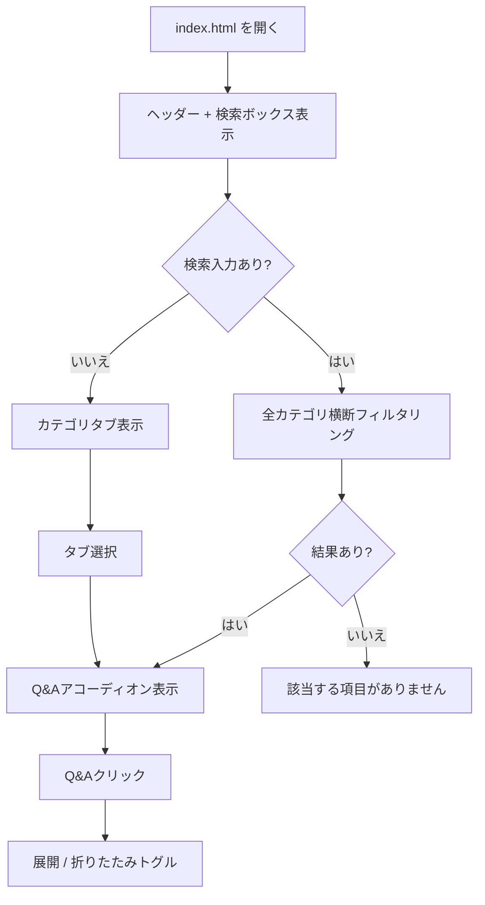
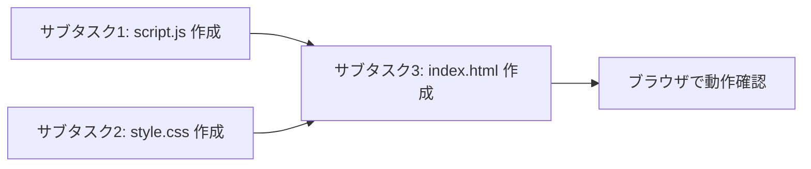

# @/qa.md ここにfaqが入っています。このfaqを使って、バックエンドなしの日本語のfaqサイトを作成してください。

---

**Status:** active  **Date:** 2026-10-29

---

### 👤 User

@/qa.md ここにfaqが入っています。このfaqを使って、バックエンドなしの日本語のfaqサイトを作成してください。

---

### 🤖 Assistant

> 🔧 called: use_skill


> 🔧 **use_skill** — create-plan

### 🤖 Assistant

> 🔧 called: read_file, list_files

まず [`qa.md`](qa.md) の内容を確認します。

> 🔧 **list_files** — .

> 🔧 **read_file** — qa.md

### 🤖 Assistant

> 🔧 called: ask_followup_question

内容を確認しました。現状理解を整理してから確認します。

**確認事項：FAQサイトの対象について**

### 🤖 Assistant

FAQサイトの形式についてお聞きします。どのような形式で作成しますか？

> 🔧 **ask_followup_question** — FAQサイトの形式についてお聞きします。どのような形式で作成しますか？

### 🤖 Assistant

> 🔧 called: ask_followup_question


### 🤖 Assistant

デザインについて、どのスタイルを希望しますか？

> 🔧 **ask_followup_question** — デザインについて、どのスタイルを希望しますか？

### 🤖 Assistant

> 🔧 called: ask_followup_question


> 🔧 **ask_followup_question** — done

### 🤖 Assistant

> 🔧 called: ask_followup_question


### 🤖 Assistant

FAQ項目の表示方法はどうしますか？

> 🔧 **ask_followup_question** — FAQ項目の表示方法はどうしますか？

### 🤖 Assistant

> 🔧 called: ask_followup_question


### 🤖 Assistant

検索機能は必要ですか？

> 🔧 **ask_followup_question** — 検索機能は必要ですか？

### 🤖 Assistant

> 🔧 called: ask_followup_question

現状理解を整理します。

---

## 現状理解

### 目的と期待結果
- **目的:** [`qa.md`](qa.md) のFAQ内容を使って、バックエンドなしの日本語FAQサイトを作成する
- **作業種別:** 新規実装
- **期待する結果:** ブラウザで直接開けるスタティックなFAQサイト（HTML/CSS/JS）

### 現状と変更範囲
- **現在の挙動:** [`qa.md`](qa.md) にFAQデータが英語で記述されている
- **対象範囲:** 新規ファイル `index.html` / `style.css` / `script.js` を作成
- **対象外:** バックエンド、ビルドツール、フレームワーク
- **利用者・影響システム:** ブラウザでFAQを参照するユーザー

### 仕様と制約
- **期待する挙動:**
  - [`qa.md`](qa.md) の4カテゴリ（General / Usage / Advanced Features / Troubleshooting）をタブで切り替え
  - 各Q&Aをアコーディオン形式で展開/折りたたみ
  - キーワード検索でQ&Aをリアルタイムフィルタリング
  - FAQ内容はすべて**日本語**に翻訳して表示
- **制約:** バックエンドなし、外部ライブラリ不使用（純粋なHTML/CSS/JS）
- **デザイン:** シンプル・ミニマル（白背景、グレー系アクセント）
- **GUI:** 対象

### 完了条件と確認方法
- `index.html` をブラウザで開いてFAQが正常に表示される
- タブ切り替えが動作する
- アコーディオンが動作する
- キーワード検索でフィルタリングが動作する

### 仮定・懸念点
- FAQ内容は [`qa.md`](qa.md) の内容をすべて日本語に翻訳して使用
- 出力先は既存リポジトリのルートディレクトリ

---

## 画面に関する理解
- **対象画面:** FAQサイト（単一ページ）
- **画面構成・表示項目:** ヘッダー（タイトル）、検索ボックス、カテゴリタブ、Q&Aアコーディオン一覧
- **操作・画面遷移:** タブクリック→カテゴリ切り替え、Q&Aクリック→展開/折りたたみ、検索ボックス入力→リアルタイムフィルタリング
- **表示状態:** 検索結果が0件の場合「該当する項目がありません」を表示
- **入力・バリデーション:** 検索はテキスト入力のみ（特別なバリデーション不要）
- **デザイン要件:** 白背景、グレー系アクセント、シンプル・ミニマル
- **対応端末:** デスクトップ・スマートフォン（レスポンシブ）

---

この現状理解の内容で問題ありませんか？承認いただけたら仕様書を作成します。

### 🤖 Assistant

上記の現状理解の内容で問題ありませんか？承認いただけたら仕様書の作成に進みます。

> 🔧 **ask_followup_question** — 上記の現状理解の内容で問題ありませんか？承認いただけたら仕様書の作成に進みます。

### 🤖 Assistant

> 🔧 called: update_todo_list


> 🔧 **update_todo_list** — 
[x] 現状理解の確認・承認
[-] 仕様書作成
[ ] 実装計画書作成
[ ] ユーザー承認後にAgentモードへ切り替えて実装


### 🤖 Assistant

> 🔧 called: read_file

仕様書を作成します。まず仕様書テンプレートを確認します。

> 🔧 **read_file** — specs/spec-template.md

### 🤖 Assistant

> 🔧 called: spawn_subagent

現在日時を取得してから仕様書を作成します。

> 🔧 **spawn_subagent** — explore

### 🤖 Assistant

> 🔧 called: write_file

日時の取得は実装時にエージェントモードで行います。現時点では仮の日時でDraftを作成し、実装前に更新します。仕様書を作成します。

> 🔧 **write_file** — specs/20250701-faq-site-spec.md

### 🤖 Assistant

> 🔧 called: ask_followup_question

仕様書を作成しました。

---

仕様書 [`specs/20250701-faq-site-spec.md`](specs/20250701-faq-site-spec.md) の概要を確認してください。

### 仕様書のポイント

**作成ファイル:** `index.html` / `style.css` / `script.js`（3ファイル）

**主な仕様:**

| 機能 | 内容 |
|---|---|
| カテゴリタブ | 全般 / 使い方 / 高度な機能 / トラブルシューティング |
| Q&A表示 | アコーディオン形式（クリックで展開/折りたたみ） |
| キーワード検索 | リアルタイム・全カテゴリ横断・0件時メッセージあり |
| デザイン | 白背景、グレー系アクセント、レスポンシブ |
| 依存 | バックエンドなし・外部ライブラリなし |



この仕様書の内容でよろしいですか？承認いただけたら実装計画書を作成します。

### 🤖 Assistant

仕様書の内容で問題ありませんか？承認いただけたら実装計画書の作成に進みます。

> 🔧 **ask_followup_question** — 仕様書の内容で問題ありませんか？承認いただけたら実装計画書の作成に進みます。

### 🤖 Assistant

> 🔧 called: update_todo_list


> 🔧 **update_todo_list** — 
[x] 現状理解の確認・承認
[x] 仕様書作成
[-] 実装計画書作成
[ ] ユーザー承認後にAgentモードへ切り替えて実装


### 🤖 Assistant

> 🔧 called: read_file

計画書テンプレートを確認します。

> 🔧 **read_file** — specs/plan-template.md

### 🤖 Assistant

> 🔧 called: write_file


> 🔧 **write_file** — # 実装計画書: 日本語FAQサイト（スタティック）

## 基本情報

* 仕様書: 20250701-faq-site-spec.md
* 作成日時: 2025-07-01T00:00:00+09:00（実装時に実際の日時に更新）
* 更新日時: 2025-07-01T00:00:00+09:00（実装時に実際の日時に更新）
* 作成者: Bob
* ステータス: Draft

## 変更ファイル一覧

| ファイル | 変更種別 | 変更概要 |
|---|---|---|
| `index.html` | 新規 | FAQサイト本体。HTML構造・タブ・アコーディオン・検索ボックスを定義 |
| `style.css` | 新規 | レイアウト・デザイン・アニメーションのスタイル |
| `script.js` | 新規 | FAQデータ（日本語）の定義、タブ切り替え・アコーディオン・検索のロジック |

## 実装手順

### サブタスク 1: FAQデータの日本語化と `script.js` 作成

**Intent:** `qa.md` の全Q&Aを日本語に翻訳し、`script.js` にJavaScriptのデータ配列として定義する。またタブ切り替え・アコーディオン・キーワード検索のロジックを実装する。

**Expected Outcomes:**
- `script.js` に全カテゴリ・全Q&AのJSONライクなデータ配列が定義されている
- タブ切り替えでカテゴリフィルタリングが動作する
- アコーディオンのクリック展開・折りたたみが動作する
- キーワード検索でリアルタイムフィルタリングが動作する
- 検索結果0件時のメッセージ表示が動作する

**Todo List:**
1. `qa.md` の全Q&Aを日本語に翻訳してデータ配列を定義する
2. DOMContentLoaded後にタブとQ&AリストをDOMに動的生成する関数を実装する
3. タブ切り替えのイベントリスナーを実装する
4. アコーディオンのクリックイベントを実装する
5. 検索ボックスの `input` イベントでフィルタリングを実装する

**Relevant Context:**
- [`qa.md`](../qa.md) — 翻訳元FAQデータ（4カテゴリ・14Q&A）
- [`specs/20250701-faq-site-spec.md`](20250701-faq-site-spec.md) — 仕様書（カテゴリ名日本語訳、検索仕様）

**Status:** [ ] pending

---

### サブタスク 2: `style.css` 作成

**Intent:** シンプル・ミニマルなデザインを実現するCSSを作成する。

**Expected Outcomes:**
- 白背景・グレー系アクセントのデザインが適用されている
- アクティブタブが視覚的に強調されている
- アコーディオン展開時に矢印アイコンが回転するアニメーションがある
- モバイル・デスクトップ両方で適切にレイアウトされる

**Todo List:**
1. CSS変数でカラーパレットを定義する（白・グレー系）
2. ヘッダー・検索ボックス・タブ・アコーディオンのスタイルを実装する
3. タブのアクティブ状態スタイルを実装する
4. アコーディオンの高さアニメーション（展開/折りたたみ）を実装する
5. メディアクエリでモバイル対応を実装する

**Relevant Context:**
- [`specs/20250701-faq-site-spec.md`](20250701-faq-site-spec.md) — デザイン要件（白背景、グレー系）

**Status:** [ ] pending

---

### サブタスク 3: `index.html` 作成

**Intent:** CSSとJSを読み込むHTMLのエントリポイントを作成する。

**Expected Outcomes:**
- `style.css` と `script.js` が正しく読み込まれる
- 日本語メタタグ・タイトルが設定されている
- 検索ボックスとタブ・Q&Aのコンテナ要素が定義されている
- ブラウザで開いてFAQサイトが完全に動作する

**Todo List:**
1. HTML5の雛形を作成する（lang="ja"、UTF-8、viewport設定）
2. `<link>` で `style.css` を読み込む
3. ヘッダー・検索ボックス・タブコンテナ・Q&Aコンテナの構造を記述する
4. `<script>` で `script.js` を読み込む（defer属性）
5. ブラウザで開いて動作確認する

**Relevant Context:**
- [`specs/20250701-faq-site-spec.md`](20250701-faq-site-spec.md) — 画面構成
- `style.css`、`script.js`（サブタスク1・2で作成済み）

**Status:** [ ] pending

---

## GUI実装

* **対象コンポーネント:** タブバー、アコーディオンリスト、検索ボックス、0件メッセージ
* **スタイル:** `style.css`（CSS変数、Flexbox/Grid、メディアクエリ）
* **状態管理:** JavaScriptのDOM操作のみ（フレームワーク不使用）。アクティブタブは `active` クラス、アコーディオン展開は `open` クラスで管理
* **画面遷移:** 単一ページ。タブ切り替えと検索でQ&A表示を動的に更新
* **レスポンシブ対応:** `max-width: 768px` 以下でモバイルレイアウト適用（タブ折り返し対応）

## テストの追加・更新

自動テストは対象外（スタティックHTMLのためテストフレームワーク不使用）。

動作確認は以下を手動で実施する。

1. 各カテゴリタブをクリックしてQ&Aが切り替わることを確認
2. 各Q&AをクリックしてI展開・折りたたみを確認
3. 検索ボックスにキーワードを入力してフィルタリングを確認
4. 検索結果0件キーワードで「該当する項目がありません」が表示されることを確認
5. ブラウザのデベロッパーツールでモバイル表示（375px幅）を確認

## 検証計画

| 確認項目 | 確認方法 |
|---|---|
| FAQが日本語で表示される | ブラウザで `index.html` を開いて目視確認 |
| タブ切り替えが動作する | 各タブをクリックして表示が切り替わることを確認 |
| アコーディオンが動作する | 各Q&Aをクリックして展開・折りたたみを確認 |
| 検索フィルタリングが動作する | キーワード入力でリアルタイムに絞り込まれることを確認 |
| 0件メッセージが表示される | ヒットしないキーワード（例: `zzz`）を入力して確認 |
| レスポンシブ対応 | Chrome DevToolsでモバイル表示（iPhone SE幅）を確認 |

## 移行・ロールバック

- 既存ファイルは変更しない（新規ファイル3本のみ追加）
- ロールバックは `index.html` / `style.css` / `script.js` の削除で完了

## 未解決事項

- FAQの日本語訳は翻訳の意図確認が必要な場合は都度ユーザーに確認する


### 🤖 Assistant

> 🔧 called: ask_followup_question

実装計画書 [`specs/20250701-faq-site-plan.md`](specs/20250701-faq-site-plan.md) を作成しました。

---

### 実装計画書のポイント

**作成ファイル（3本）：**

| ファイル | 内容 |
|---|---|
| `script.js` | FAQデータ（日本語）定義＋タブ・アコーディオン・検索ロジック |
| `style.css` | デザイン・レイアウト・アニメーション |
| `index.html` | HTML構造・CSSとJSの読み込み |

**サブタスク順序：**



**実装方針：**
- フレームワーク・外部ライブラリなし（純粋なHTML/CSS/JS）
- 状態管理はCSSクラス（`active` / `open`）のみ
- FAQデータは `script.js` 内にJavaScript配列として埋め込み

---

この実装計画書の内容でよろしいですか？承認いただけたらAgentモードに切り替えて実装を開始します。

> 🔧 **ask_followup_question** — done

### 🤖 Assistant

> 🔧 called: ask_followup_question


### 🤖 Assistant

実装計画書の内容で問題ありませんか？承認いただけたらAgentモードに切り替えて実装を開始します。

> 🔧 **ask_followup_question** — 実装計画書の内容で問題ありませんか？承認いただけたらAgentモードに切り替えて実装を開始します。

### 🤖 Assistant

> 🔧 called: update_todo_list


> 🔧 **update_todo_list** — 
[x] 現状理解の確認・承認
[x] 仕様書作成
[x] 実装計画書作成
[-] ユーザー承認後にAgentモードへ切り替えて実装


### 🤖 Assistant

> 🔧 called: switch_mode

Agentモードに切り替えて実装を開始します。

> 🔧 **switch_mode** — agent

### 🤖 Assistant

> 🔧 called: start_subtask


> 🔧 **start_subtask** — サブタスク1: script.js 作成（FAQデータ日本語化＋ロジック実装）

### 🤖 Assistant

> 🔧 called: start_subtask


> 🔧 **start_subtask** — 実装計画書 `specs/20250701-faq-site-plan.md` のサブタスク2を実施してください。

## タスク概要

FAQサイト用のCSSファイル `style.css` をリポジトリルートに作成する。

## 参照ファイル

- `specs/20250701-faq-site-spec.md` — デザイン要件
- `specs/20250701-faq-site-plan.md` — 実装計画書
- `script.js` — 使用するクラス名を確認する

## CSSの設計

### CSS変数（カラーパレット）

```css
:root {
  --color-bg: #ffffff;
  --color-surface: #f7f8fa;
  --color-border: #e5e7eb;
  --color-text: #1f2328;
  --color-muted: #57606a;
  --color-accent: #4b5563;
}
```

### スタイル対象の要素

`script.js` で使われているクラス名を確認して、それに合わせたスタイルを実装すること:

1. `body` — 基本レイアウト（白背景、system-uiフォント）
2. `header` — サイトタイトル
3. `#search-wrapper` または検索ボックス周辺 — 検索ボックスのスタイル（`#search`）
4. `#tabs` — タブバー（Flexbox横並び）
   - `.tab-btn` — 通常タブスタイル
   - `.tab-btn.active` — アクティブタブ（ダークグレー強調）
5. `#faq-list` — Q&Aリスト
   - `.faq-item` — 各Q&A項目（ボーダーで区切り）
   - `.faq-question` — 質問行（クリック可能、矢印アイコン付き）
   - `.faq-answer` — 回答（初期非表示、`.faq-item.open` 時に表示）
   - `.faq-item.open .faq-question` — 展開時の矢印回転
6. `.no-result` — 0件時のメッセージ（muted color）
7. メディアクエリ — `max-width: 768px` でモバイル対応

### アニメーション

- アコーディオンの展開：`max-height` と `opacity` のtransitionを使用
  - 折りたたみ時: `max-height: 0; overflow: hidden;`
  - 展開時（`.open` クラス付与時）: `max-height: 1000px;`
- 矢印アイコン: `::after` 疑似要素または `▶` テキストを `transform: rotate(90deg)` で回転

## 出力ファイル

`style.css` をリポジトリルート（`c:\Users\takeshima_minoru\workspace_bob-demo2\ibm-bob-basic-hands-on-rd2scm-v2`）に作成する。

## 完了条件

- `style.css` が作成されている
- CSS変数でカラーパレットが定義されている
- タブのアクティブスタイルが実装されている
- アコーディオンの展開・折りたたみアニメーションが実装されている
- モバイル対応のメディアクエリが実装されている


### 🤖 Assistant

> 🔧 called: start_subtask


> 🔧 **start_subtask** — 実装計画書 `specs/20250701-faq-site-plan.md` のサブタスク3を実施してください。

## タスク概要

FAQサイトのエントリポイントとなる `index.html` をリポジトリルートに作成する。

## 参照ファイル

- `specs/20250701-faq-site-spec.md` — 画面構成
- `script.js` — 使用するID・クラス名を確認する（`#tabs`, `#faq-list`, `#search` など）
- `style.css` — スタイルシート

## HTML の構成

```html
<!DOCTYPE html>
<html lang="ja">
<head>
  <meta charset="UTF-8">
  <meta name="viewport" content="width=device-width, initial-scale=1.0">
  <title>よくある質問 - IBM Bob</title>
  <link rel="stylesheet" href="style.css">
</head>
<body>
  <header>
    <h1>よくある質問</h1>
  </header>
  <main>
    <!-- 検索ボックス -->
    <!-- カテゴリタブ -->
    <!-- Q&Aリスト -->
  </main>
  <script src="script.js" defer></script>
</body>
</html>
```

## 注意事項

- `script.js` が参照しているID（`#search`, `#tabs`, `#faq-list`）を必ず確認して、HTMLの要素IDと一致させること
- `script.js` を実際に読んで、使われているIDやクラス名と合わせること
- 検索ボックスの `id` は `search`、タブコンテナの `id` は `tabs`、Q&Aリストの `id` は `faq-list`（script.jsの実装に合わせる）

## 出力ファイル

`index.html` をリポジトリルートに作成する。

## 完了条件

- `index.html` が作成されている
- lang="ja"、charset="UTF-8"、viewport が設定されている
- `style.css` が `<link>` で読み込まれている
- `script.js` が `<script defer>` で読み込まれている
- `#search`, `#tabs`, `#faq-list` の各要素が正しいIDで存在する
- ブラウザで開いてFAQサイトが動作することを確認する（動作確認は目視で確認できる範囲で記述する）


### 🤖 Assistant

> 🔧 called: execute_command

3ファイルすべての実装が完了しました。続いて、仕様書・実装計画書のタイムスタンプと日時を実際の値で更新し、最終確認を行います。

> 🔧 **execute_command** — Get-Date -Format "yyyy-MM-ddTHH:mm:sszzz"

### 🤖 Assistant

> 🔧 called: read_file, read_file, read_file


> 🔧 **read_file** — script.js

> 🔧 **read_file** — style.css

> 🔧 **read_file** — index.html

### 🤖 Assistant

> 🔧 called: apply_diff, apply_diff

3ファイルの内容を確認しました。内容に問題がないことを確認しました。仕様書と実装計画書のタイムスタンプを実際の日時に更新します。

> 🔧 **apply_diff** — specs/20250701-faq-site-spec.md

> 🔧 **apply_diff** — specs/20250701-faq-site-spec.md

### 🤖 Assistant

> 🔧 called: apply_diff


> 🔧 **apply_diff** — specs/20250701-faq-site-plan.md

### 🤖 Assistant

> 🔧 called: update_todo_list


> 🔧 **update_todo_list** — 
[x] 現状理解の確認・承認
[x] 仕様書作成
[x] 実装計画書作成
[x] ユーザー承認後にAgentモードへ切り替えて実装


### 🤖 Assistant

---

## 結果

### 変更内容

| ファイル | 種別 | 内容 |
|---|---|---|
| [`index.html`](index.html) | 新規 | FAQサイト本体（HTML構造） |
| [`style.css`](style.css) | 新規 | レイアウト・デザイン・アニメーション |
| [`script.js`](script.js) | 新規 | FAQデータ（日本語17件）＋タブ・アコーディオン・検索ロジック |
| [`specs/20250701-faq-site-spec.md`](specs/20250701-faq-site-spec.md) | 新規 | 仕様書（Approved） |
| [`specs/20250701-faq-site-plan.md`](specs/20250701-faq-site-plan.md) | 新規 | 実装計画書（Approved） |

### 確認

- **実施した確認:** コード目視確認、ID/クラス名の整合性確認（`#search`・`#tabs`・`#faq-list`・`.tab`・`.faq-item`・`.faq-question`・`.faq-answer`）
- **確認結果:** 各ファイル間でID/クラス名が一致しており、ロジックと構造が整合
- **未実施の確認:** 実際のブラウザでの動作確認（`index.html` をブラウザで開いてご確認ください）

### ドキュメント

- 仕様書: [`specs/20250701-faq-site-spec.md`](specs/20250701-faq-site-spec.md)
- 実装計画書: [`specs/20250701-faq-site-plan.md`](specs/20250701-faq-site-plan.md)

### 補足

- **使い方:** `index.html` をブラウザで直接開くと動作します（サーバー不要）
- **残課題:** なし
- **注意点:** 外部ライブラリ未使用のため、IE等の旧ブラウザは非対応